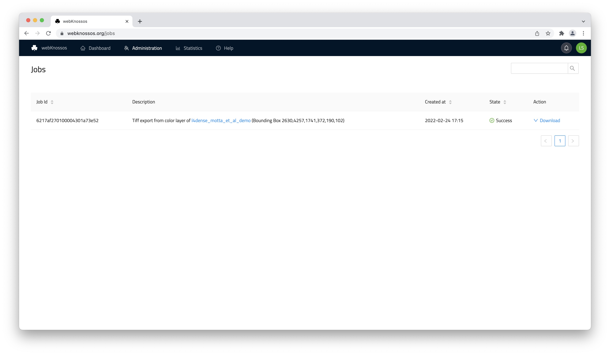

# Jobs

webknossos.org includes several compute-intensive and automated workflows that are processed in the background. Depending on the operation and dataset size, these workflows may take some time (from minutes to hours) to finish. 

WEBKNOSSOS will notify you via email upon completion or failure of any job.

Example workflows:

- [AI segmentation](./ai_segmentation.md), e.g. running AI model for nuclei segmentation and mitochondria detection  
- [converting datasets on upload](../data/upload_ui.md)
- [mesh file (pre)-computation](../meshes/loading_meshes.md)
- [applying a merger mode annotation](../proofreading/merger_mode.md)
- automatic inference of a segmentation layer's large segment ID
- [dataset & annotation export as TIFF or OME-Zarr files](../data/export_ui.md)
- [creating engaging animations of datasets](./animations.md)
- downsampling volume annotations

These workflows are executed in background worker tasks as so-called *processing jobs*. 

!!! info
    These workflows are exclusive to webknossos.org. Contact [sales](mailto:sales@webknossos.org) for access to the WEBKNOSSOS worker or [Voxelytics](https://voxelytics.com) for the job processing.

## Listing Processing Jobs
A list of all past and currently running jobs can be found in the analysis menu in the navbar (`Analysis > Processing Jobs`). The list shows your own jobs. Admins see all jobs of their organization.

/// caption
Overview of the Jobs page
///

The table has the following columns:

| Column | Description |
|--------|-------------|
| `Job Id` | The ID of the job. |
| `Description` | What the job does and on which dataset or annotation. Use the filter icon in the column header to show only certain job types. For AI training jobs, `Show Training Data` opens the annotations used for training. |
| `Owner` | The user who started the job. |
| `Cost in Credits` | The [credits](#credits) charged for the job. Jobs that don't cost credits show `-`. |
| `Date` | When the job was started. |
| `State` | `Pending`, `Started`, `Success`, `Failure`, or `Cancelled`. Hover over the state for an explanation. Use the filter icon to show only jobs in certain states. |
| `Action` | Actions for the job (see below). |

Use the search field above the table to filter jobs by dataset name. The list refreshes automatically.

Depending on the job type and state, the `Action` column offers:

- **View**: Open the resulting dataset or segmentation, e.g., after a conversion, AI segmentation, or materialization.
- **Download**: Download the result, e.g., a [TIFF export](../data/export_ui.md) or an [animation](./animations.md).
- **Cancel**: Stop a job that is pending or running. After you confirm, the job is cancelled and any credits reserved for it are refunded.
- **Retry**: Restart a failed or cancelled job. The workflow continues from the failed step and reuses the results of steps that already succeeded. You can retry a job once. If the job costs credits, your organization needs enough credits for the retry, and they are charged again. If a retried job fails again, the failure is likely persistent; [contact support](mailto:support@webknossos.org) (or your administrator on self-hosted instances).
- **Show Error**: Open the `Job Error Details` with the error message of a failed job.

We constantly monitor job executions. In rare cases, jobs can fail, and we aim to re-run them as quickly as possible. In case you run into any trouble, please [contact us](mailto:support@webknossos.org).

## Workflow Reports

Some processing jobs run as [Voxelytics](https://voxelytics.com) workflows. On instances with Voxelytics integration, each workflow creates a detailed report. To browse all reports, select `Analysis > Voxelytics` in the navbar. This menu entry only appears if Voxelytics reporting is enabled on your WEBKNOSSOS instance. Admins and dataset managers see all workflow reports of their organization; other users only see their own.

You can also open the report of a training job directly from the [`AI Models` page](./ai_training.md#managing-ai-models): click `Voxelytics Report` next to a trained model.

The `Voxelytics Workflows` list shows each workflow with its user, host, progress, file size of its outputs, and begin and end times. Click a workflow to open its report:

- **Task graph**: On the left, the report shows the workflow steps (tasks) and their dependencies as a graph. Click a task to jump to its details. Grouped tasks can be expanded and collapsed with `Expand in DAG` / `Collapse in DAG`.
- **Task list**: On the right, every task is listed with its state, progress, and runtime. Use `Filter tasks` to search for a task. If a workflow was run several times, select a specific run in the dropdown, or `Consolidated` to see the combined state of all runs.
- **Task details**: Expand a task to see its tabs:

| Tab | Description |
|-----|-------------|
| `Description` | A description of the task, if available. |
| `Config` | The configuration the task was run with. |
| `Output Artifacts` | The data the task produced, with version, file size, and storage path. `Download checksums` downloads the checksums of the artifact files as CSV. |
| `Input Artifacts` | The artifacts of other tasks this task depends on. Click one to jump to the producing task. |
| `Logs` | The log output of the task. You can filter by log level, show timestamps, and download the full log. Only available after selecting a specific run. |
| `Statistics` | Memory, CPU, and duration statistics of the task's executions. |

The dropdown next to `Collapse All` offers additional actions: `Copy All Artifact Paths`, `Download Report as JSON`, `Download Workflow YAML`, `Download Log` (for a specific run), and `Show Disk Usage of Artifacts`.

## Credits

Compute-intensive AI jobs — [AI segmentation/inference](./ai_segmentation.md), [AI model training](./ai_training.md), and [alignment](./alignment.md) — are paid for with WEBKNOSSOS credits. The cost of a job depends on the size of the processed data (and the job type), so it scales with the bounding box and magnification you select.

- **Estimating the cost:** Each AI job dialog includes a `Credit Information` step that shows your organization's available credits and the estimated cost for the configured job *before* you start it. We recommend a test run on a small bounding box first.
- **Free monthly credits:** Every organization receives a free credit allotment each month to trial AI jobs. Unused credits expire at the end of the month.
- **Checking your balance and history:** Your current balance is shown as `AI Credits` on the `Organization` page. The `Credit Activity` page (under your organization settings) lists all credit purchases, spending, and refunds for your organization. (Admin users only)
- **Refunds:** If a job fails, the credits it consumed are refunded automatically.
- **Buying more credits:** Only the organization owner can purchase additional credits. To buy more, [contact us](mailto:sales@webknossos.org).