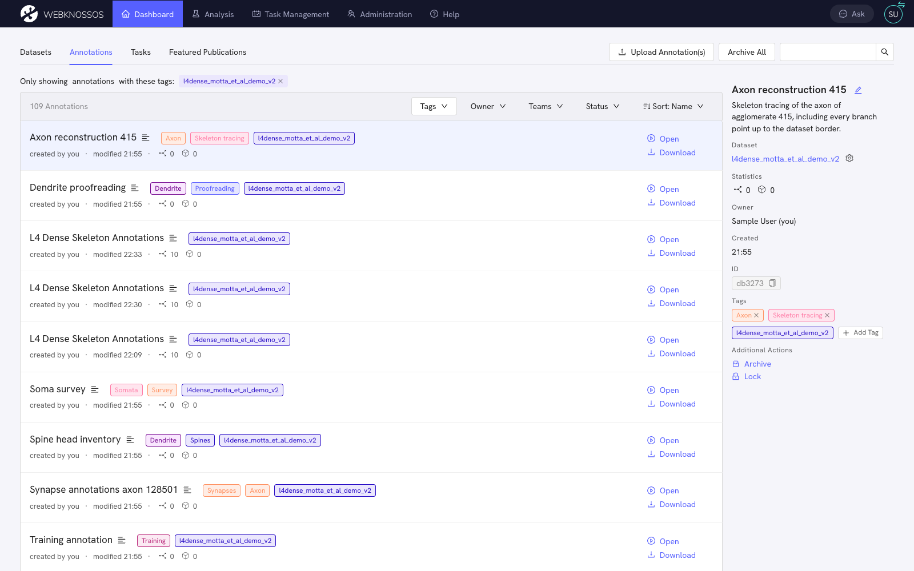
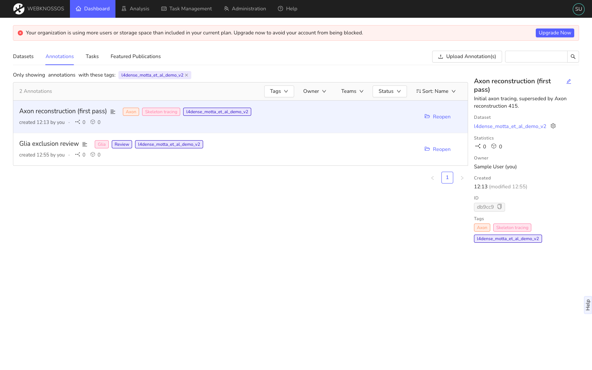

# Annotations Dashboard

This page lists all your annotations (skeleton, volume or both) that you started on a dataset (outside of tasks) and annotations that were shared with you. Annotations are either created by starting new annotations from the "Datasets" tab, from the WEBKNOSSOS data viewer, or by uploading an existing annotation from your computer (see [NML files](../data/concepts.md#nml-files) for skeleton annotations).

Annotations can be resumed, archived (like delete, but reversible), and downloaded for offline analysis.
You can also add custom tags to annotations to organize and group them. Click on one or multiple of your tags if you want to filter a particular group of annotations.
Each annotation can be renamed to reflect its content.

Each row in the list offers the **Open** and **Download** actions.
Click on a row to show its **Details** sidebar. There, you can rename the annotation, edit its tags, and find further actions such as **Archive** and **Lock**/**Unlock**.

/// caption
Manage and resume your skeleton and volume annotations.
///

/// caption
Annotations can be archived to declutter your dashboard.
///

## Archived Annotations

To archive an annotation, click **Archive** in its **Details** sidebar. This is only possible for annotations you can edit. Locked annotations need to be unlocked first.

Archived annotations are hidden from the annotation list by default. To find them, open the **Status** filter above the annotation list and select **Archived** (instead of the default **Open**). Archived annotations cannot be edited. Click **Reopen** next to an archived annotation to move it back to your open annotations.

## Shared Annotations

The annotations tab also shows all annotations that were shared by other collaborators of your organization. Only annotations shared through the "Team Sharing" mechanic will be listed provided your user account is part of the respective team. Read more about sharing your own annotations in the [Sharing guide](../sharing/annotation_sharing.md).

You can view the linked annotations (read-only) or copy them to your account for modification.