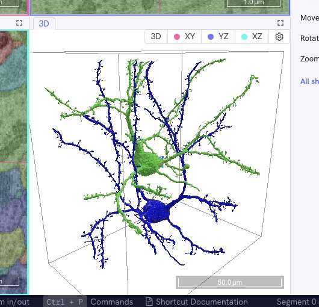

# Mesh Visualization

WEBKNOSSOS turns volumetric segmentations into 3D surface meshes. Meshes are rendered in the 3D viewport in the lower right corner and can be downloaded as STL files for use in other software such as Blender, 3D Slicer, ParaView, or for 3D printing.

/// caption
A mesh of a large neuron segment in the 3D viewport.
///

## Precomputed vs. Ad-hoc Meshes

WEBKNOSSOS offers two ways to get a mesh for a segment:

| | Precomputed meshes | Ad-hoc meshes |
| --- | --- | --- |
| **How they are created** | Computed once for all segments of a dataset by a background job | Computed on demand for a single segment |
| **Loading time** | Almost instant, even for large segments | Slower, especially for large segments |
| **Reflects your annotation edits** | No, they show the segmentation at the time they were computed | Yes, they are computed from the current data |
| **Availability** | Only if a mesh file exists for the dataset | Always available for visible segmentation layers |

## In This Section

- [Loading Meshes](./loading_meshes.md): load precomputed meshes, compute ad-hoc meshes, and generate mesh files for a whole dataset.
- [Working with Meshes](./working_with_meshes.md): show, hide, and select meshes, navigate with them, and download or export them as STL files for Blender, 3D Slicer, or 3D printing.
