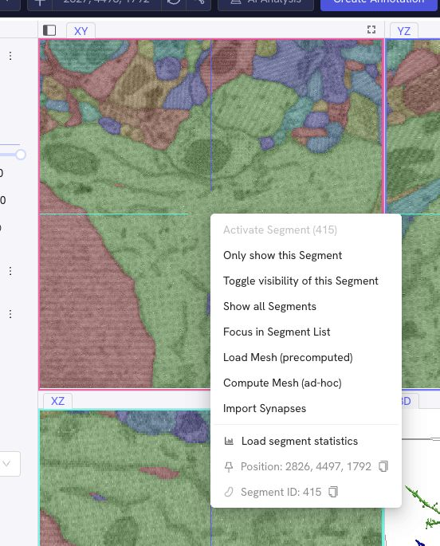
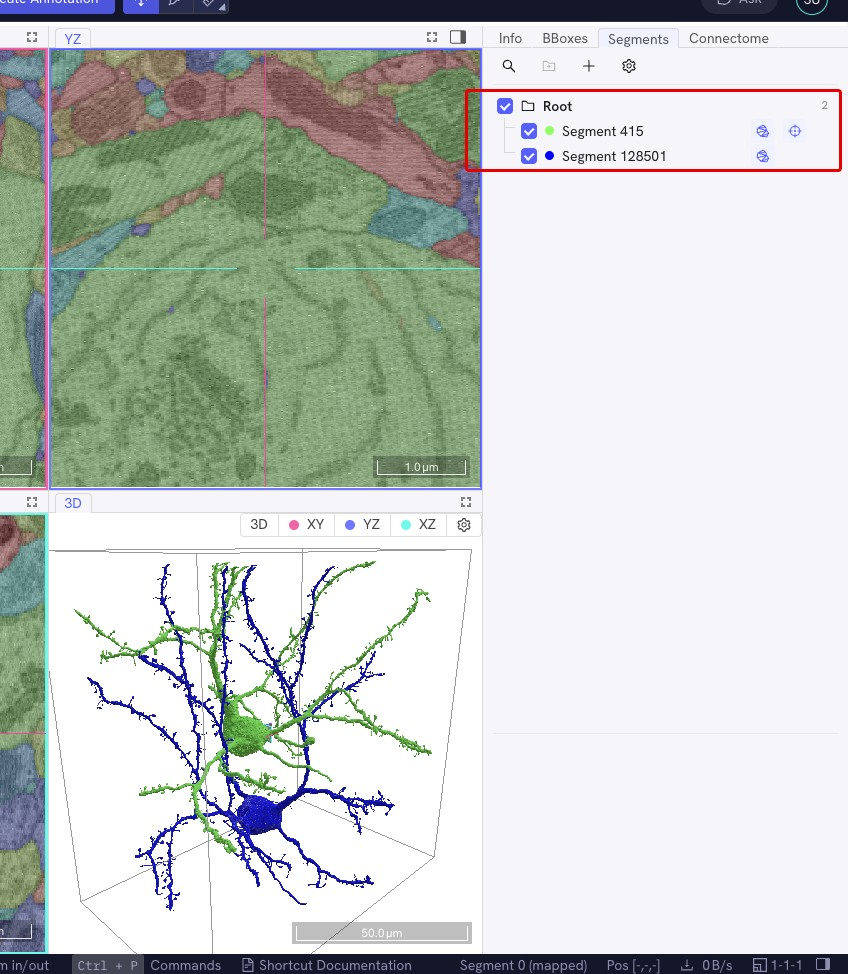
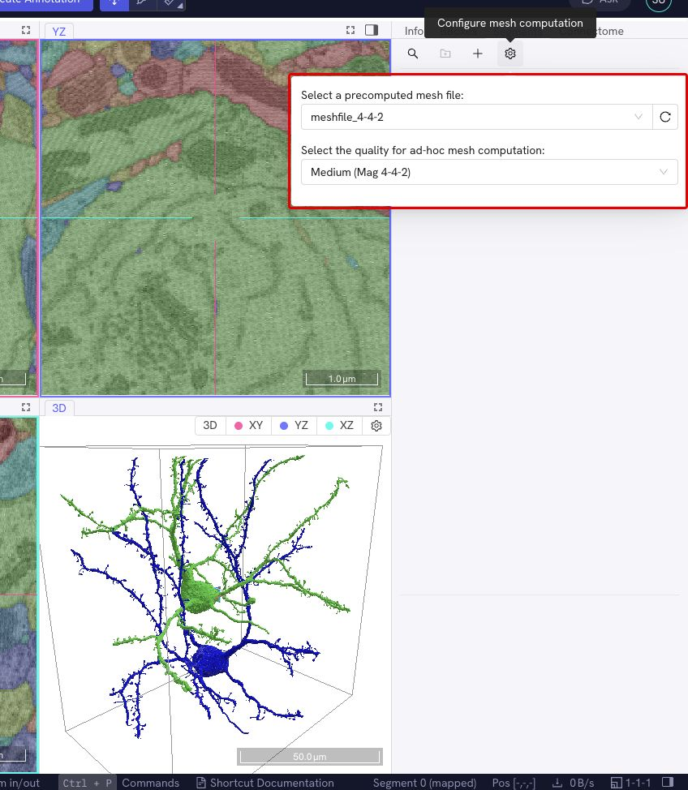

# Loading Meshes

You can load a mesh for any segment of a visible segmentation layer. If the segmentation layer is hidden, all mesh actions are disabled.

## Loading a Mesh

There are two places to load meshes from:

- **The data viewports:** Right-click a segment and select `Load Mesh (precomputed)` or `Compute Mesh (ad-hoc)` from the [context menu](../ui/context_menu.md).
- **The `Segments` tab:** In the right-hand side panel, hover over a segment and click its mesh button. If a precomputed mesh file is available, you can choose between the precomputed and the ad-hoc mesh. Otherwise, an ad-hoc mesh is computed. Right-click a segment or a whole group of segments for the same options.

Once loaded, the mesh appears as a chip in the segment's row of the `Segments` tab. Click the chip to show or hide the mesh.

/// caption
Meshes can be loaded from the context-sensitive right-click menu.
///

/// caption
The `Segments` tab lists all loaded meshes.
///

## Ad-hoc Meshes

Ad-hoc meshes are computed on demand for individual segments, based on the current segmentation data. This makes them the right choice for segments you are actively editing.

- **Quality:** Configure the mesh quality in the settings popover (gear icon) in the `Segments` tab header. Higher quality yields a more detailed mesh but takes longer to compute.
- **Large segments:** Computing an ad-hoc mesh for a large segment can take a long time, because the server needs to load and process a lot of voxel data. If you regularly work with large segments, [generate a precomputed mesh file](#generating-precomputed-mesh-files) instead.

## Precomputed Meshes

Precomputed meshes are computed in advance for all segments of a dataset and load almost instantly, even for large segments.

### Choosing a Mesh File

A dataset can have multiple precomputed mesh files, for example one per magnification. Coarser magnifications produce coarser meshes that load faster. Finer magnifications yield more detail but load slower.

To switch between mesh files:

1. Click the settings (gear) icon at the top of the `Segments` tab.
2. Select the desired mesh file from the dropdown.
3. If a newly generated mesh file is missing, click the reload button next to the dropdown to refresh the list.

/// caption
If more than one mesh file is available, e.g., based on different magnifications, you can select it from a dropdown.
///

### Generating Precomputed Mesh Files

Instead of computing meshes one by one, you can precompute meshes for all segments of a dataset at once:

1. Click the plus (`+`) button at the top of the `Segments` tab.
2. Choose the mesh quality. We recommend the default medium quality for a good balance between visual fidelity, compute time, and GPU memory usage.
3. Start the job.
4. Track progress or cancel the job on the [`Processing Jobs` page](../automation/jobs.md) in the `Analysis` menu.
5. Once the job has finished, reload the page to use the new mesh file.

You can run the job multiple times with different quality levels to get several mesh files to choose from.

!!! info
    Precomputing meshes is exclusive to webknossos.org. Contact [sales](mailto:sales@webknossos.org) for access to the integrated WEBKNOSSOS worker for meshing or the [Voxelytics software](https://voxelytics.com) for standalone meshing from the command line.
