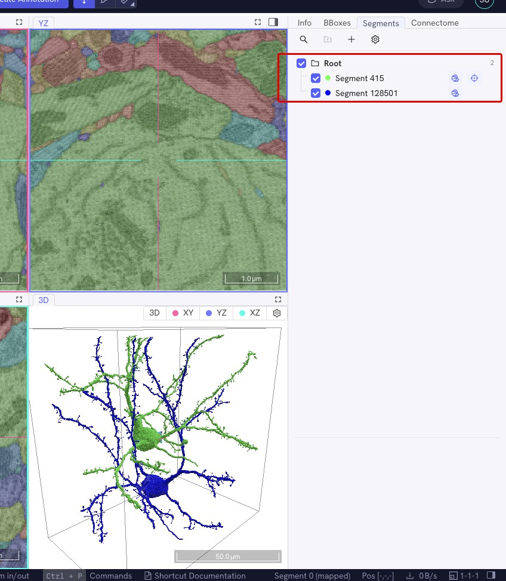

# Working with Meshes

Once you have [loaded meshes](./loading_meshes.md), you can show and hide them, use them to navigate the dataset, and download them as STL files for other software.

Watch this short walkthrough of working with meshes in WEBKNOSSOS:

## Managing Meshes in the Segments Tab

The `Segments` tab lists all segments and their meshes.

- **Show or hide a mesh:** Click the mesh chip in the segment's row.
- **More actions:** Right-click a segment or a group of segments, or use the `···` button that appears when hovering over it. From there, you can show, hide, refresh, remove, or [download](#downloading-meshes) the meshes.

/// caption
The `Segments` tab lists all segments of the dataset. You can load, hide, and remove meshes for each segment here.
///

## Interacting with Meshes in the 3D Viewport

| Interaction | Effect |
| --- | --- |
| ++shift++ + Click on a mesh | Moves the current position to the clicked point on the mesh. |
| ++ctrl++ / ++cmd++ + Click on a mesh | Selects the mesh and makes its segment the active segment. Click it again to deselect it. |
| Right-click on a mesh | Opens the [mesh context menu](../ui/context_menu.md#meshes-in-the-3d-viewport) to hide, reload, or remove the mesh, or to jump to the clicked position. |

!!! info "3D viewport background"
    The background of the 3D viewport follows your [theme](../users/password.md#theme): it is black in dark mode and white in light mode. With `System Default`, it follows your operating system's current theme.

## Downloading Meshes

You can download meshes as STL files, the industry-standard format for 3D surface models:

1. [Load the meshes](./loading_meshes.md) of the segments you want to export.
2. In the `Segments` tab, right-click a segment or a group of segments.
3. Select `Download Meshes`.

WEBKNOSSOS downloads a ZIP archive with one STL file per segment, named `<segment name>-<segment ID>.stl`. The meshes are exported in the quality in which they are currently loaded. For the most detailed result, load a fine precomputed mesh file or increase the ad-hoc mesh quality before downloading.

Mesh coordinates are given in the physical unit of the dataset's voxel size, typically nanometers. Many tools assume millimeters, so you may need to scale the mesh after importing it.

## Using Meshes in Other Software

Since STL is supported by almost all 3D tools, you can use your exported segmentations in many applications:

- **Blender:** Render images and animations of your segmentation. Use `File > Import > STL`. Our blog series on [making great videos for biomedical microscopy data](https://medium.com/scalableminds/how-to-make-great-videos-for-biomedical-microscopy-data-51218ffa2421) walks you through it.
- **3D Slicer:** Drag the STL files into the 3D Slicer window, or use `File > Add Data`. Each file is loaded as a model. To convert it into a segmentation, right-click the model in the `Data` module and choose `Convert model to segmentation node`.
- **3D printing:** Open the STL file in your 3D printing software (e.g., PrusaSlicer, Cura, or Bambu Studio) and scale it to the desired print size. Depending on the segment, you may need to repair or simplify the mesh first, e.g., with MeshLab or Blender.
- **ParaView, MeshLab, and other 3D viewers:** Import the STL files directly for further analysis or visualization.

!!! tip "Exporting voxel data instead of meshes"
    If you need the segmentation as a voxel volume (e.g., a labelmap for 3D Slicer, Fiji, or napari) rather than as a surface mesh, export the segmentation layer as a TIFF stack, OME-TIFF, or OME-Zarr from the [`Download` dialog](../data/export_ui.md#exporting-tiff-ome-zarr-cutouts).

## Meshes in Animations

You can include meshes in [WEBKNOSSOS animations](../automation/animations.md) to create videos of your segmentation without any external software.
