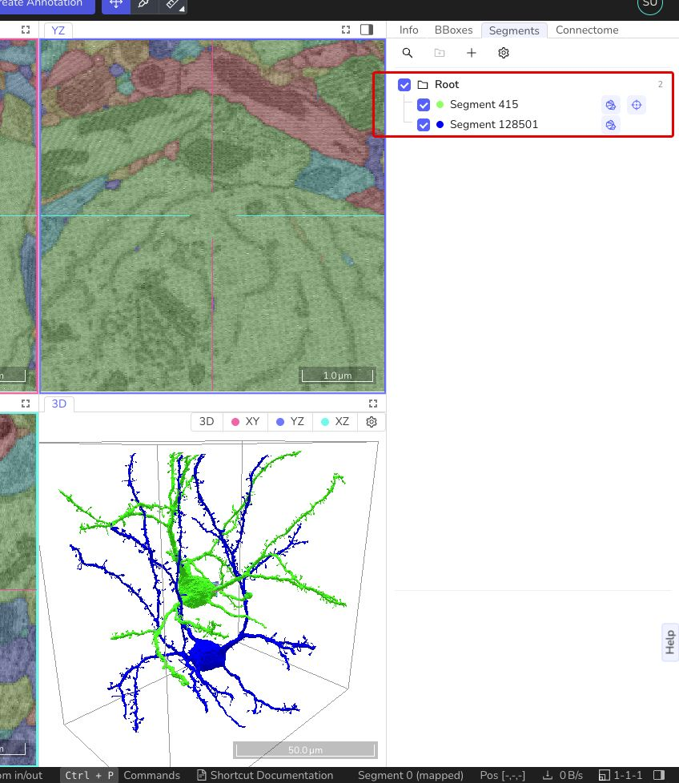

# Working with Meshes

Any meshes listed in the `Segments` tab can be downloaded as an industry-standard STL file for further rendering/animation, e.g., in Blender ([Read more in this blog series](https://medium.com/scalableminds/how-to-make-great-videos-for-biomedical-microscopy-data-51218ffa2421)). Right-click a segment in the list (or use the `···` button that appears when hovering over it) to download, refresh, or remove its mesh.

Watch this short walkthrough of working with meshes in WEBKNOSSOS:

Mesh visibility can also be toggled from the `Segments` tab by clicking the mesh chip in the segment's row.

++shift++ + Click on any mesh in the 3D viewport will navigate WEBKNOSSOS to that position.
++ctrl++ / ++cmd++ + Click on any mesh selects it and makes its segment the active segment. Click it again to deselect it.

/// caption
The segments tab contains a list of all segments in the dataset. You can load, hide, and remove meshes for each segment here.
///

Additionally, hiding, removing, reloading a mesh or jumping to its hovered position can be done with the context menu in the 3D viewport via right-click on a hovered mesh.

You can also include meshes in [WEBKNOSSOS animations](../automation/animations.md).
