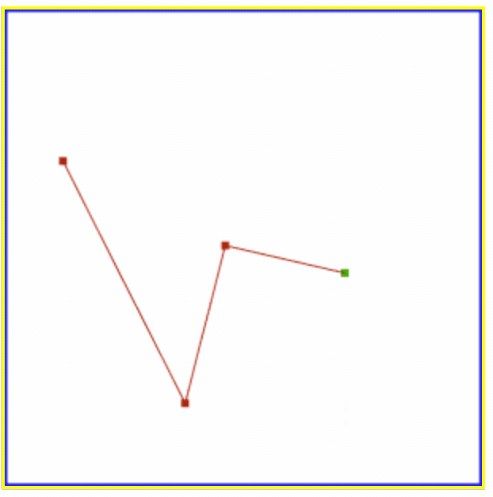

# Skeleton operations

## Operations with the Context Menu

WEBKNOSSOS has a context menu that can be opened via _Right Click_. This context menu offers useful context-sensitive information and most operations should be available through it:

/// caption
Example of the context menu
///

Right-clicking a node lets you, for example, delete it, mark it as a branchpoint, merge or split trees, extract the shortest path to it, or measure path lengths. Right-clicking elsewhere lets you create a new node or tree. For a full list of items, see the [Context Menu reference](../ui/context_menu.md).

## Merging / Splitting Trees

Common tree operations include splitting and merging trees.

- `Tree splitting` can be done in two ways:

    1. Delete the node at which to split. This can be done by right-clicking a node and choosing "Delete this Node". If you have enabled _Classic Controls_, you need to select (++shift++ + Left Click) the node first and then delete (++del++) it.
    2. Delete an edge between two nodes. Select the first node (_Left Click_), then right-click the second node and select _Delete Edge to this Node_. If you have enabled _Classic Controls_, you need to select the first node with ++shift++ + Left Click and then click on the second node of the edge with ++shift++ + ++ctrl++ + Left Click to delete this connection.

- `Tree merging` works similarly to edge deletion but will create a new edge between two previously unconnected trees. Select the first node and right-click on a second one to choose _Create Edge & Merge with this Tree_. When using _Classic Controls_, the second node needs to be selected with ++shift++ + ++alt++ + Left Click to create an edge between the two.

/// caption
Trees can be split by deleting the edge between two nodes or deleting a node. Two trees can be merged again by creating a new edge between them.
///