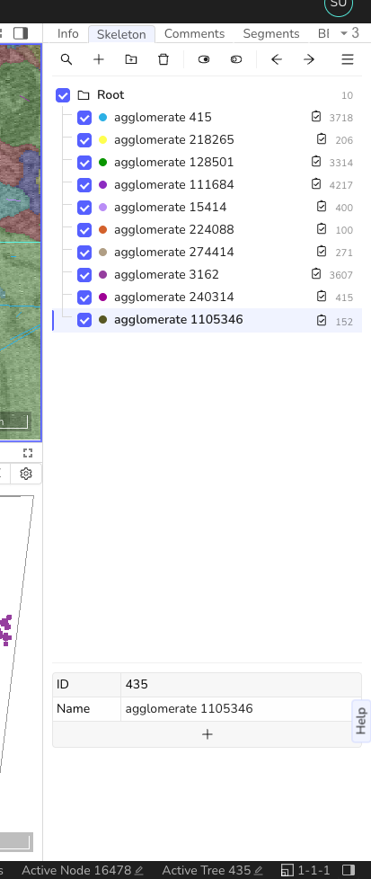
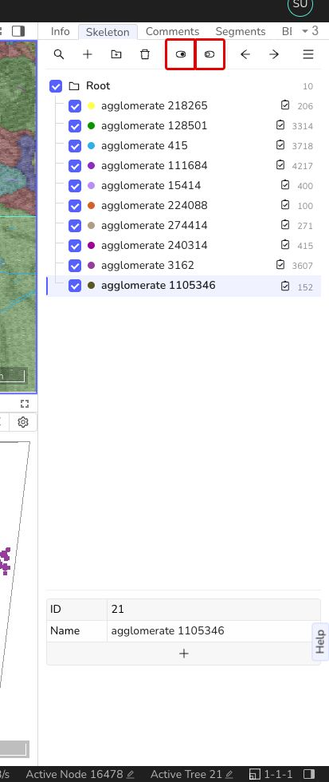

# Skeleton Tree List

The `Skeleton` tab in the right-hand side panel lists all trees of your skeleton annotation.
Use it to select, rename, recolor, hide, and organize trees, and to attach [metadata](#tree-metadata) to them.

/// caption
Organize your skeleton annotation's trees to remember important structures for later reference
///

## Tree Rows

Each tree is shown as a single row with a visibility checkbox, a dot in the tree's color, its name, and its number of nodes at the right end.
Additional icons mark agglomerate skeletons created while [proofreading](../proofreading/proofreading_tool.md) and trees that have metadata.

- **Click** a tree to select it and make it the active tree.
- ++ctrl++ + click (++cmd++ + click on macOS) adds a tree to or removes it from a multi-selection.
- ++shift++ + click selects all trees between the active tree and the clicked one. This only works for trees within the same group.
- **Double-click** the name to rename the tree. Press ++enter++ to save or ++escape++ to cancel.
- **Right-click** the row to open the [tree context menu](#tree-context-menu).

The **active tree**, i.e. the one that new nodes are added to, is marked with a colored bar at the left edge of its row and a bold name.
When you hover over a row, the node count is replaced by a `···` (More actions) button that opens the same menu as a right-click.

### Tree Context Menu

The menu header shows the tree's ID and its number of nodes.

| Action | Description |
| --- | --- |
| `Rename Tree` | Turns the name into an input field, just like double-clicking it. |
| `Change Tree Color` | Opens a color picker to choose a new color for the tree. |
| `Shuffle Tree Color` | Assigns a new random color to the tree. |
| `Duplicate Tree` | Creates a copy of the tree named `<name> (copy)`. |
| `Delete Tree` | Deletes the tree. |
| `Measure Tree Length` | Shows a notification with the total length of the tree's edges, both in the dataset's unit and in voxels. |
| `Hide/Show All Other Trees` | Makes this tree the active tree and toggles the visibility of all other trees. |
| `Hide/Show Edges of This Tree` | Toggles whether the edges of this tree are rendered. The nodes stay visible. |
| `Convert to Normal Tree` | Turns an agglomerate skeleton from proofreading into a regular tree. Only shown for agglomerate skeletons. |

!!! info
    In read-only annotations, all editing actions are disabled.
    In annotations that are edited by several users at the same time, only agglomerate skeletons can be edited, and group operations are disabled.

## Tree Groups

Trees can be nested and organized in so-called `Tree Groups`.
Tree groups can have a name and are used to structure and label your annotation even further.
Each group row shows the number of trees it contains, including those of its subgroups.
Trees that are not in a group belong to the top-level `Root` group.

There are two ways to create a group:

- To create a new top-level group, click the `Create new Group` button (the folder icon with a plus) in the toolbar of the `Skeleton` tab.
- To create a subgroup, right-click an existing tree group and select `Create new group` from the context menu. The new group is created inside the group you clicked.

Trees can be dragged and dropped between tree groups.
If the dragged tree is part of a multi-selection, all selected trees are moved.
Groups can be dragged into other groups as well.
To rename a group, double-click its name or use `Rename group` from its context menu.
Collapsing a group also collapses all of its subgroups.

### Group Context Menu

Right-click a group (or use the `···` button that appears on hover) to open its context menu.
The menu header shows how many trees the group contains.
Actions that affect trees apply to all trees of the group and its subgroups. On the `Root` group, they apply to all trees.

| Action | Description |
| --- | --- |
| `Create new group` | Creates a subgroup inside this group. |
| `Rename group` | Turns the group name into an input field. Not available for the `Root` group. |
| `Move active tree here` | Moves the active tree, the selected trees, or the active group into this group. The label changes to `Move active trees here` or `Move active group here` accordingly. Only shown if something is active. |
| `Delete group` | Asks whether to `Remove group including all children` or to `Remove group and keep children`. In the latter case, the group's trees and subgroups are moved up one level. |
| `Collapse all subgroups` / `Expand all subgroups` | Collapses or expands the whole group hierarchy below this group. Only shown if the group has subgroups. |
| `Hide/Show all other trees` | Makes this group active and toggles the visibility of all trees outside of it. |
| `Shuffle Tree Group Colors` | Assigns new random colors to all trees of the group. |
| `Change Tree Group Color` | Assigns one color to all trees of the group. |

## Toolbar

The toolbar at the top of the `Skeleton` tab is divided into groups of buttons:

| Button | Description |
| --- | --- |
| Search (magnifier icon) | Searches tree and group names (also ++ctrl+shift+f++ while the tab is open), see [Searching Trees](#searching-trees). |
| `Create new Tree` | Creates a new, empty tree and makes it active (++c++). |
| `Create new Group` | Creates a new top-level group. |
| `Delete Selected Trees` | Deletes the selected trees after a confirmation, or the active tree if only one is selected. If a group is active, you are asked whether to delete it. |
| `Toggle Visibility of All Trees` | Hides or shows all trees (++1++). |
| `Toggle Visibility of Inactive Trees` | Hides or shows all trees except the active one (++2++). |
| `Select previous tree` / `Select next tree` | Activates the previous or next tree in the current sort order, regardless of groups. |
| `More actions` (menu icon at the right end) | Opens the menu described below. |

The `More actions` menu contains:

| Action | Description |
| --- | --- |
| `Sort` | Sorts the list `by name` or `by creation time`. |
| `Shuffle All Tree Colors` | Assigns new random colors to all trees. |
| `Download Visible Trees NML` | Downloads all visible trees as an [NML file](./import_export.md). |
| `Download Visible Trees CSV` | Downloads all visible trees as a ZIP archive with `trees.csv`, `nodes.csv`, and `edges.csv`. |
| `Download Visible Trees NML (Transformed)` / `Download Visible Trees (Transformed) CSV` | Same as above, but with the currently active transformation applied to each node. Only shown if the skeleton layer is transformed. |
| `Import NML` | Opens a dialog to [import NML files](./import_export.md#import-skeleton-annotations) into the annotation. |
| `Measure Length of All Skeletons` | Shows a notification with the total length of all trees. |

### Searching Trees

Click the magnifier icon or press ++ctrl+shift+f++ while the `Skeleton` tab is open to search for trees and groups by name.
The search is case-insensitive and matches any part of the name.

- Press ++enter++ or ++shift+enter++ to jump to the next or previous match. The matching tree becomes the active tree, and its parent groups are expanded.
- Click `Select all matches (except groups)` to select all matching trees at once, e.g. to move them into a group via drag and drop or to delete them.
- Press ++escape++ to close the search.

## Details Panel

Below the list, a details panel shows information about the current selection.
Drag the divider above it to resize it.

- If **one tree** is selected, the panel shows its ID, its name, and its [metadata](#tree-metadata).
- If **several trees** are selected, it shows how many.
- If **a group** is active, it shows the group's ID, its name, and the number of trees it contains. For groups with subgroups, both the number of direct children and the total number including all subgroups are shown.

The name can be edited directly in the panel, too.

## Tree Metadata

You can attach your own key-value properties to a tree, for example to record a cell type, a review status, or a confidence score.
Trees with metadata are marked with a tag icon in the list.
Select a single tree to edit its metadata in the [details panel](#details-panel):

1. Click the `+` button below the name (`Add a new metadata property`) and choose the type of the value:
    - `Text`: a single string
    - `Number`: a numeric value
    - `Multi-Item Text`: a list of strings, entered as tags. Tags that are already used in other properties of the same tree are suggested.
2. Enter the property name in the `Property` field. Each key can only be used once per tree.
3. Enter the value.

To remove a property, click the `×` button at the end of its row.
Metadata cannot be edited in read-only annotations.

Tree metadata is included in [NML exports](./import_export.md) and restored when you import an NML file.
See the [NML format description](../data/concepts.md#metadata-entries) for how the entries are stored.
Segments support the same kind of metadata, see the [Segments list](../volume_annotation/segments_list.md#segment-metadata).

## Tree Colors

A random color is assigned to each tree upon creation.
Colors can be shuffled for a single tree or for all trees in a skeleton.
Right-click on a tree to bring up several actions, e.g. `Shuffle Tree Color`.
To recolor several trees at once, right-click a tree group and select `Change Tree Group Color` or `Shuffle Tree Group Colors`, or select `Shuffle All Tree Colors` from the `More actions` menu at the end of the `Skeleton` tab's toolbar.
All nodes have the same color as their parent tree and can not be changed individually.
The active node, branch points, and nodes that have comments assigned to them are highlighted with a slight variation of the tree's color.

/// caption
Trees are randomly assigned colors upon creation.
Users can assign new colors to a single tree or all trees at once.
///

## Skeleton & Tree Visibility

The visibility of individual trees can be toggled to hide some trees for a better overview.
Toggle the checkbox before each tree name or tree group to hide/show it.
Alternatively, toggle all trees at once using the `Toggle Visibility of All Trees` / `Toggle Visibility of Inactive Trees` buttons in the toolbar of the `Skeleton` tab.
There are also keyboard shortcuts to quickly toggle the visibility:

| Key Binding | Operation                           |
| ----------- | ----------------------------------- |
| 1           | Toggle Visibility of all Trees      |
| 2           | Toggle Visibility of Inactive Trees |

To hide only the edges of a tree, right-click it and select `Hide/Show Edges of This Tree`.

/// caption
Trees can be hidden for a better overview of the data. Toggle the visibility of an individual tree using the checkbox in front of the tree's name or use the button to toggle all (inactive) trees at once.
///
