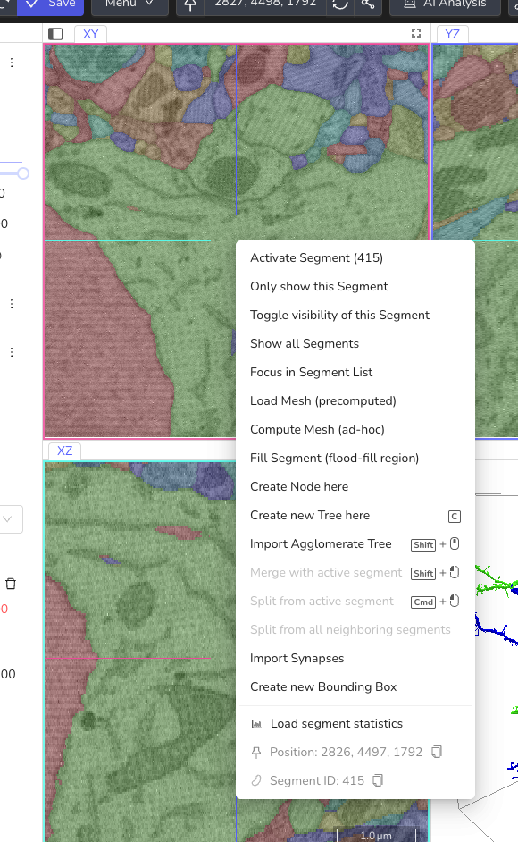
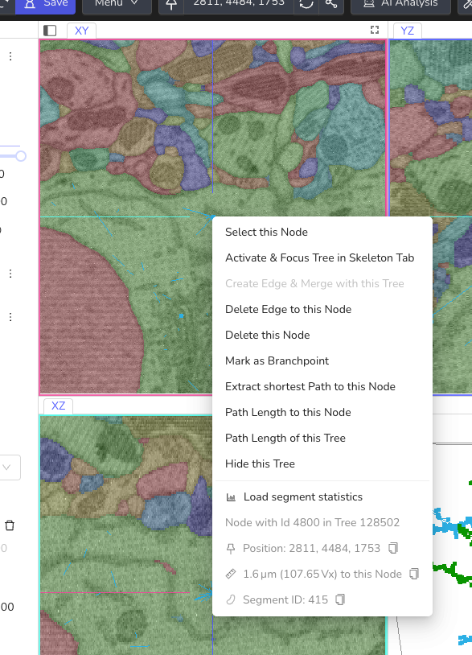

# Context Menu

Right-click in one of the data viewports (XY, YZ, XZ) or in the 3D viewport to open the context menu. It lists the actions available for the thing under the cursor, such as a skeleton node, a segment, a mesh or a bounding box. At the bottom, it shows information about the clicked position.

/// caption
The context menu for a segment in the XY viewport
///

The right-click opens the context menu with most tools. There are a few exceptions:

- The **Measurement** tools use right-click to finish or reset a measurement.
- With *Classic Controls* enabled, right-click places a node when using the Skeleton tool. Use ++shift++ + Right Click to open the context menu. With the Brush and Trace tools, right-click erases. See [Keyboard & Mouse Shortcuts](./keyboard_shortcuts.md#classic-controls).

Which items are shown depends on what you clicked, the active tool, and whether you can edit the annotation. For example, editing actions are hidden when you only view a dataset or a read-only annotation. Hover over a grayed-out item to see why it is unavailable.

## Skeleton Nodes

Right-click a node to open the node menu. Several items compare the clicked node to the *active* node, so select a node first (Left Click) and then right-click a second one.

/// caption
The context menu for a skeleton node
///

| Item | Description |
|------|-------------|
| Select this Node | Makes the clicked node the active node. Disabled if it is already active. |
| Activate & Focus Tree in Skeleton Tab | Makes the node active and selects its tree in the [Skeleton tab](../skeleton_annotation/trees_list.md). |
| Perform Min-Cut (Experimental) | Only shown if the tree has exactly two nodes and the annotation has a volume layer. Uses the two nodes as seeds to split the segment between them in the volume annotation. A submenu lets you choose the bounding box for the operation: the default one or one of your bounding boxes that contains both nodes. Not available with an editable mapping (after proofreading) or while the view is rotated. |
| Create Edge & Merge with this Tree | Connects the active node with the clicked node and merges both trees. Disabled if both nodes are in the same tree. |
| Perform Min-Cut between these Nodes | Proofreading tool only. Splits the agglomerate between the active node and the clicked node. Both must be in the same tree. See [Proofreading Tool](../proofreading/proofreading_tool.md#working-with-agglomerate-trees). |
| Split from all neighboring segments | Proofreading tool only. Cuts the segment under the node from all its neighbors in the agglomerate. |
| Delete Edge to this Node | Deletes the edge between the active node and the clicked node, splitting the tree. Disabled if the two nodes are not connected directly. |
| Delete this Node | Deletes the clicked node. |
| Mark as Branchpoint / Unmark as Branchpoint | Toggles whether the node is a [branchpoint](../skeleton_annotation/operations.md). |
| Extract shortest Path to this Node | Copies the shortest path between the active node and the clicked node into a new tree. Both nodes must be in the same tree. |
| Path Length to this Node | Shows the length of the shortest path between the active node and the clicked node. Both nodes must be in the same tree. |
| Path Length of this Tree | Shows the total length of all edges in the tree. |
| Hide this Tree | Hides the tree. You can show it again in the Skeleton tab. |

The items from *Create Edge & Merge with this Tree* to *Extract shortest Path to this Node* are only available if you can edit the annotation. In a [collaborative annotation with simultaneous editing](../sharing/annotation_sharing.md#simultaneous-editing-experimental), they are only shown for agglomerate trees. *Extract shortest Path to this Node* and *Path Length to this Node* are not shown when you right-click the active node itself.

If you right-click a node in the 3D viewport that lies on a mesh, the [mesh items](#meshes-in-the-3d-viewport) are listed as well.

For more on working with trees, see [Skeleton Operations](../skeleton_annotation/operations.md).

## Segments and Empty Space

Right-click anywhere in a data viewport that is not a node to see this menu. The segment items require a visible segmentation layer.

### Segment Items

| Item | Description |
|------|-------------|
| Activate Segment (ID) | Makes the clicked segment the active segment, so that further brushing or filling uses its ID. Disabled if the annotation has no volume layer or the segment is already active. |
| Only show this Segment | Hides all other segments, including those not in the [Segments list](../volume_annotation/segments_list.md). |
| Toggle visibility of this Segment | Hides or shows the clicked segment. |
| Show all Segments | Shows all segments again, for example after *Only show this Segment*. |
| Focus in Segment List | Adds the segment to the Segments list, if it is not listed yet, and selects it there. |
| Load Mesh (precomputed) | Loads the segment's mesh from the active mesh file. Disabled if the dataset has no mesh file. A warning icon means that the segmentation data has changed since the mesh file was created, so the mesh may not match. See [Loading Meshes](../meshes/loading_meshes.md#precomputed-meshes). |
| Compute Mesh (ad-hoc) | Computes a mesh for the segment on the fly. See [Loading Meshes](../meshes/loading_meshes.md#ad-hoc-meshes). |
| Fill Segment (flood-fill region) | Relabels the clicked region with the active segment ID. Only shown if you can edit the annotation and the Fill tool is available, for example not while the view is rotated. See [Volume Flood Fills](../volume_annotation/tools.md#volume-flood-fills). |

*Activate Segment*, *Only show this Segment*, *Toggle visibility of this Segment* and *Show all Segments* are only shown if there is a segment at the clicked position.

### Skeleton, Agglomerate and Synapse Items

The following items require a skeleton layer and that you can edit the annotation. *Import Synapses* is the only exception: It also works when only viewing a dataset.

| Item | Description |
|------|-------------|
| Create Node here | Adds a node at the clicked position to the active tree. |
| Create new Tree here | Creates a new tree that starts with a node at the clicked position. |
| Import Agglomerate Tree | Loads the agglomerate skeleton of the clicked segment. Needs an active agglomerate mapping. Without one, a warning icon is shown, and clicking the item explains why it is not available. |
| Add/Remove Segment to Partition 1 / Partition 2 | Proofreading tool with multi-split mode only. Adds the clicked supervoxel to a partition, or removes it. See [Multi-Split Mode](../proofreading/proofreading_tool.md#fixing-merge-errors-with-multi-split-mode). |
| Split partitions | Multi-split mode only. Shown once both partitions contain at least one supervoxel. Splits the segment between the two partitions. |
| Merge with active segment | Merges the clicked segment into the active segment. |
| Split from active segment | Splits the clicked part from the active segment using a min-cut. |
| Split from all neighboring segments | Cuts the clicked supervoxel from all its neighbors in the agglomerate. |
| Import Synapses | Loads the synapses of the clicked segment from the active connectome file. Without a connectome file, a warning icon is shown, and clicking the item explains why it is not available. See [Synapse and Connectome Viewer](../connectome_viewer.md). |

*Create Node here* and *Create new Tree here* are disabled while the skeleton layer is transformed and in annotations with simultaneous editing.

*Merge with active segment*, *Split from active segment* and *Split from all neighboring segments* are only shown if an agglomerate mapping is active, and they can only be used with the [Proofreading tool](../proofreading/proofreading_tool.md). With other tools, they are grayed out.

### Bounding Box Items

Right-clicking close to the edge of a visible [bounding box](./object_info.md#bounding-boxes-tab) adds items to manage that box.

| Item | Description |
|------|-------------|
| Create new Bounding Box | Creates a new bounding box around the clicked position. Also available when not clicking near a bounding box. Disabled while the view is rotated. |
| Focus in Bounding Box Tab | Selects the bounding box in the Bounding Boxes tab. |
| Change Bounding Box Name | Opens a text field to rename the bounding box. Press ++enter++ to confirm. |
| Change Bounding Box Color | Opens a color picker to change the bounding box color. |
| Hide Bounding Box | Hides the bounding box. You can show it again in the Bounding Boxes tab. |
| Delete Bounding Box | Deletes the bounding box. |

If you cannot edit the annotation, only *Hide Bounding Box* is available.

## Meshes in the 3D Viewport

Right-click a mesh in the 3D viewport to open the mesh menu.

| Item | Description |
|------|-------------|
| Select Segment (ID) | Makes the segment of the mesh the active segment. With the Proofreading tool, this selects the clicked supervoxel instead. The item then reads *Select Supervoxel (within Segment ID)*. If the supervoxel is already selected, the item changes to *Deselect Supervoxel*. |
| Hide Mesh | Hides the mesh. You can show it again in the Segments list. |
| Reload Mesh | Reloads the mesh, for example after the segmentation has changed. |
| Jump to Position | Moves the current position to the clicked point on the mesh. |
| Remove Mesh | Removes the mesh from the 3D viewport. |

The mesh items require a segmentation layer that belongs to the annotation, and they are not available while the view is rotated. See [Working with Meshes](../meshes/working_with_meshes.md).

With the Proofreading tool active, the following items are added:

| Item | Description |
|------|-------------|
| Add/Remove Supervoxel to Partition 1 / Partition 2, Split partitions | Multi-split mode only. Same as in the [data viewports](#skeleton-agglomerate-and-synapse-items). |
| Merge with active segment | Merges the segment of the clicked mesh into the active segment. Disabled if the mesh already belongs to the active segment. |
| Split from active segment | Splits the clicked supervoxel from the active segment. Only available if the clicked mesh belongs to the active segment, a supervoxel is selected, and the clicked supervoxel is a different one. |
| Split from all neighboring segments | Cuts the clicked supervoxel from all its neighbors in the agglomerate. |

These proofreading items only work for meshes that were loaded while the Proofreading tool was active and that are not based on a mapping. Otherwise, the items are grayed out, and their tooltip explains what to do, for example to reload the mesh.

## Information Section

The bottom part of the menu shows information about the clicked position.

| Entry | Description |
|-------|-------------|
| Load segment statistics | Shown when you click a segment or mesh, and the segmentation layer supports statistics. Saves the annotation and then loads the statistics listed below. The menu stays open. After loading, the item reads *Reload segment statistics*. |
| Node with Id … in Tree … | The IDs of the clicked node and its tree. Only shown for nodes. |
| Position | The coordinates of the clicked node or position. Not shown in the 3D viewport. |
| Distance | The distance from the active node to the clicked node or position, in physical units and in voxels. Only shown if there is an active node. |
| Segment ID | The ID of the clicked segment or mesh. |
| Segment Name | The name of the segment, if it has one in the Segments list. |
| Surface Area, Volume, Bounding Box | The segment statistics, shown after clicking *Load segment statistics*. Only the values the segmentation layer can provide are shown. The bounding box is given as top-left corner and size, in voxels. See [Segment Statistics](../volume_annotation/segments_statistics.md). |
