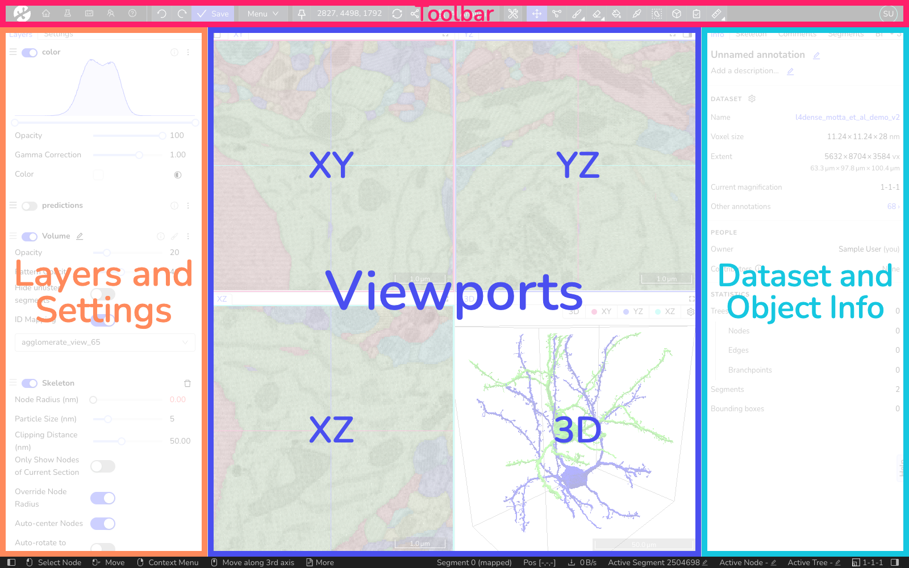
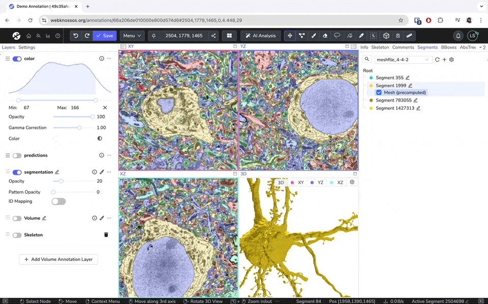

# Understanding the User Interface

The main WEBKNOSSOS user interface for viewing and annotating datasets is divided into five sections:

1. A [toolbar](./toolbar.md) for general-purpose features such as saving your work and displaying the current position within the dataset. Further, it provides access to all the tools for annotating and manipulating your data. It spans along the full width of the top of your screen.
2. The [left-hand side panel](./layers.md) provides a list of all available data, segmentation, and annotation layers as well as a settings menu for viewport options and keyboard controls.
3. The center of the screen is occupied by the annotation interface. Your dataset is displayed here, and you navigate and annotate it as desired. Most interactions will take place here.
4. The [right-hand side panel](./object_info.md) is occupied by several tabs providing more information on your current dataset, skeleton/volume annotations, and other lists. Depending on your editing mode these tabs might adapt.
5. The bottom of the screen is covered by a status bar showing context-sensitive hints for mouse controls as well as additional information on mouse hover.

/// caption
An overview of the WEBKNOSSOS annotation UI highlighting the main sections of the interface
///

You can customize the interface to your liking. Toggle the left and right sidebars, and drag the viewport edges to adjust the view. To reset the layout, go to Menu > Layout > Reset Layout in the toolbar.

/// caption
Customizing the layout by dragging and resizing the viewports.
///

## Command Palette
Press ++ctrl++ / ++cmd++ + ++p++ to open the command palette. Start typing to search for a command and press ++enter++ to run it. The command palette is available everywhere in WEBKNOSSOS, including the dashboard and admin pages. Its shortcut can't be changed in the keyboard shortcut settings.

Available everywhere (when logged in):

- `View Dataset`, `View Annotation`: Press ++enter++ to load a list of your datasets or annotations (most recently modified first), then search and select one to open it.
- `Switch Organization`: Press ++enter++ to list your other [organizations](../users/organizations.md#switching-organizations) and switch to one.
- `Go to …`: Navigate to pages such as the datasets, annotations, and tasks dashboards, time tracking, and, depending on your role and the enabled features, admin and analysis pages (e.g., users, teams, jobs, AI models, project progress).
- `Switch to "System-default" / "Light" / "Dark" color theme`: Change the color theme.
- `Copy Organization ID`, `Copy Auth Token`: Copy these values to the clipboard, e.g., for use with the [Python library](https://docs.webknossos.org/webknossos-py/).

Additionally available while viewing a dataset or annotation:

- `Switch to …` a tool, e.g., `Switch to Brush Tool`. In view-only mode or if you can't edit the annotation, only the read-only tools are listed.
- `Switch to orthogonal mode`, `Switch to flight mode`, and `Reset layout`.
- All entries of the toolbar `Menu`, e.g., `Download`, `Share`, `Duplicate`, or `Restore Older Version`.
- `Toggle …` commands for on/off user settings, e.g., `Toggle Center New Node`.

Read More About [Skeleton Annotation](../skeleton_annotation/index.md)

Read More About [Volume Annotation](../volume_annotation/index.md)