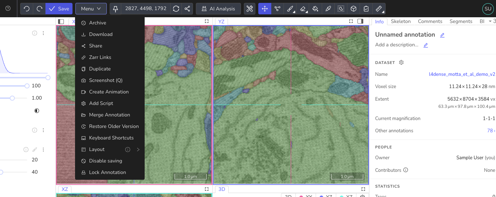
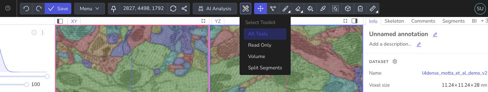
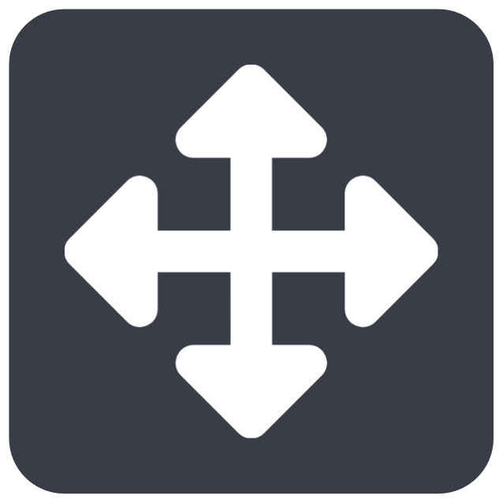
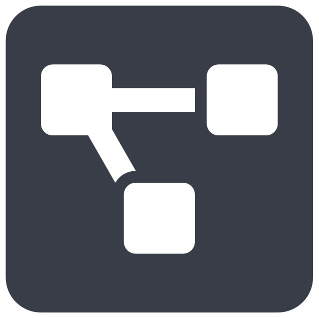
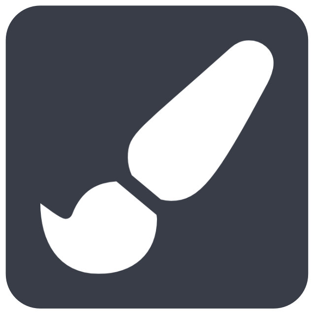
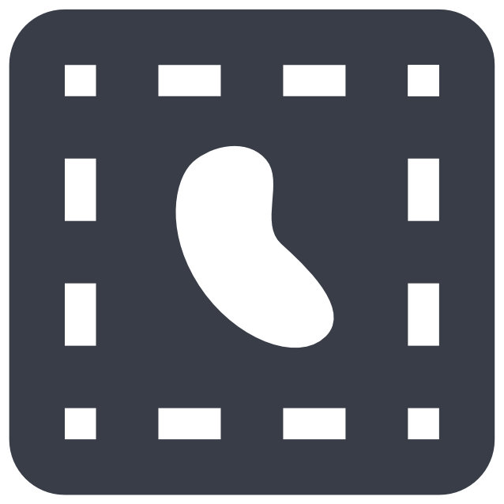
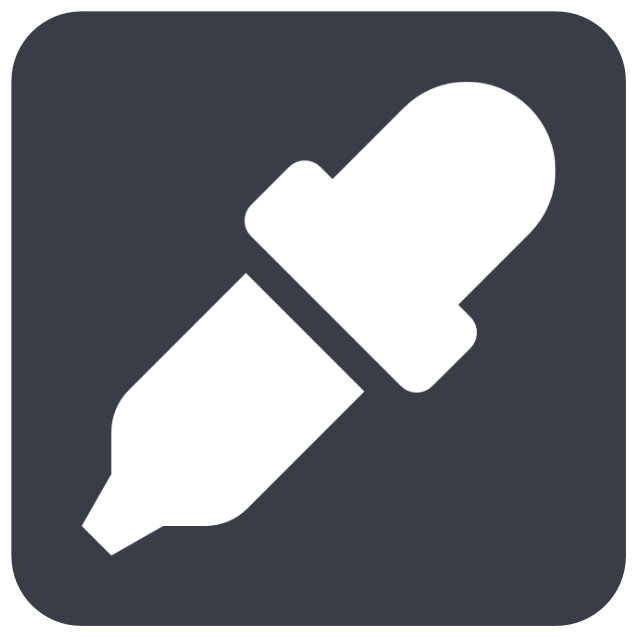
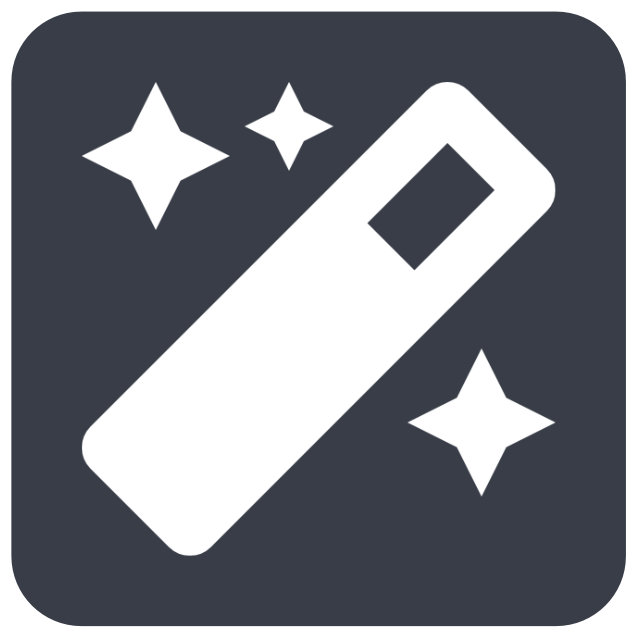
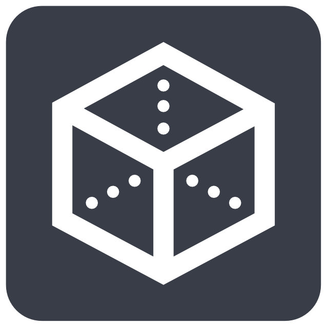

# The Toolbar

The toolbar is your primary interface for switching between tools and modes in WEBKNOSSOS. Located at the top of the screen, it provides quick access to essential functions for viewing, annotating, and sharing your work.

/// caption
The WEBKNOSSOS toolbar contains many useful features for quick access such as Saving and Undo/Redo
///

## Basic Operations

### Save and Undo
The save and undo functions help you manage your annotation work:

- The **Save** button preserves your current work. While WEBKNOSSOS automatically saves every 30 seconds, you can manually save at any time using the keyboard shortcut ++ctrl++ / ++cmd++ + ++s++.

- The **Undo/Redo** buttons let you reverse or restore recent changes. The undo function (++ctrl++ / ++cmd++ + ++z++) can revert any changes made in your current session, while redo (++ctrl++ / ++cmd++ + ++y++) restores previously undone changes. For accessing older versions of your work, use the [version history](#version-history).

### Position Control
The position control allows precise navigation within your dataset. You can:

- Enter specific coordinates to jump directly to any location
- Copy position values by clicking on the pushpin icon.
- Rotate the viewports and toggle flight mode with the rotation button next to the position input (see [Rotating the Viewports](#rotating-the-viewports))
- The position information is automatically included when sharing your view with colleagues
- Quick Share: Generate an immediate sharing link that includes your current view settings. This is ideal for rapid collaboration or when you need to quickly show something to a colleague.

### Rotating the Viewports
Rotation isn't limited to [flight mode](../skeleton_annotation/modes.md). In orthogonal (plane) mode, you can rotate the three viewport planes to follow structures that don't run parallel to the dataset axes.

Hover over the rotation button (circular arrows icon) next to the position input to open the rotation popover:

- **Flight Mode**: Switch between orthogonal and flight mode. The switch is disabled if flight mode isn't allowed for the current annotation (e.g., in some tasks).
- **Rotation**: Use the `X`, `Y`, and `Z` sliders (0–360°) to rotate the planes around each axis. The arrow button next to each slider resets that axis to 0.
- **Reset all**: Resets the rotation of all axes to 0.

While the view is rotated, the rotation button is highlighted in orange as a reminder.

You can also rotate with the keyboard. The rotation axis depends on the active viewport:

- ++shift++ + ++left++ / ++right++ / ++up++ / ++down++ rotates the planes left/right/up/down.
- ++alt++ + ++left++ / ++right++ rolls the planes within the active viewport.

The keyboard rotation speed can be adjusted with the `Keyboard Rotation` setting in the [Controls settings](./layers.md). All bindings can be [customized](./keyboard_shortcuts.md#customizing-shortcuts). The current rotation is also stored in [sharing links](../sharing/annotation_sharing.md#link-sharing).

!!! info "Limitations while rotated"
    Some tools only work on an unrotated view. While the viewports are rotated, the volume annotation tools (Brush, Trace, their erase variants, Fill Tool, and Quick Select), the Proofreading tool, the Bounding Box tool, and the area measurement tool are disabled. Hovering over a disabled tool shows the reason. Reset the rotation to 0, 0, 0 to use them again.

    The `Only Show Nodes of Current Section` setting is also unavailable while the view is rotated.

## Menu Functions

### File Operations
The menu provides several ways to manage your annotations:

- **Download**: Export your work in standard formats:

    - Skeleton annotations are saved as [NML files](../data/concepts.md#nml-files)
    - Volume annotations are exported as [WKW files](../data/wkw.md)
    - All associated data and metadata are included in the download

- **Archive**: When you need to declutter your dashboard, you can archive annotations you're not actively working on. Archived items remain accessible through the "Show Archived Annotations" filter on your dashboard. Note that this option isn't available for tasks.

- **Restore Older Version**: Browse the complete version history of your annotation, preview older versions, and restore them. See [Version History](#version-history) below.

- **Merge Annotations**: Combine multiple annotations into one either by project or by annotation ID.

- **Disable Saving**: Temporarily disable automatic saving in WEBKNOSSOS. Any changes you make will not be saved. This can reduce bandwidth and resource usage when working with large annotations that don't need to be persisted.

- **Lock Annotation**: Lock your current annotation in a read-only mode to protect it from any accidental changes. The annotation remains read-only until you unlock it (from the [Annotation dashboard](../dashboard/annotations.md)). This can be useful when publishing your work or sharing with larger communities.

### Version History
WEBKNOSSOS keeps a version history of every annotation. Each saved change creates a new version. Unlike undo/redo, which only covers your current session, the version history lets you go back to any earlier state of the annotation. It is also the way to revert changes where undo isn't available, e.g., proofreading actions or edits during [simultaneous editing](../sharing/annotation_sharing.md#simultaneous-editing-experimental).

To open it, select `Menu` > `Restore Older Version` in the toolbar (not available in sandbox mode). Any pending changes are saved first. The `Version History` panel then opens on the right side of the screen. As long as it is open, the annotation is read-only.

The history is a single, linear list for the whole annotation and covers all of its layers: skeleton, volume, and proofreading changes, as well as changes to bounding boxes, segment lists, and annotation layers.

- **Grouping**: Versions are grouped by day (`Today`, `Yesterday`, or the date). Versions that were created within a few minutes of each other are combined into a collapsible group labeled with the version range and time, e.g., `120 to 134 (14:05)`. Click a group to expand it.
- **Entries**: Each entry shows the version number, the time, a short description of the most important change in that version (e.g., "Created the node with id 12." or "Merged agglomerates …"), and its author. The latest version is marked as `Newest version`.
- **Preview**: Click an entry to load that version into the viewports. You can navigate and inspect it, but not edit it.
- **Restore**: While previewing an older version, click `Restore` next to it. This doesn't delete the newer versions. Instead, WEBKNOSSOS adds a new version ("Reverted to version …") with the restored state, so you can always go back again.
- **Download**: If you are not allowed to edit the annotation, the button reads `Download` instead and downloads the previewed version.
- **Load More**: Long histories are loaded in pages. Use `Load More` at the bottom of the list to load older versions (or at the top for newer ones).

Close the panel with the `X` button to return to the newest version and continue annotating.

!!! info "Live collaboration"
    If the annotation is edited by several users at the same time, restoring an older version requires confirmation and reloads WEBKNOSSOS for all collaborators. See [Simultaneous Editing](../sharing/annotation_sharing.md#simultaneous-editing-experimental) for details.

### Collaboration Tools
WEBKNOSSOS offers multiple ways to share your work:

- **Share**: Create customized sharing links that capture your current view, including position, rotation, and zoom level. You can set specific access permissions to control who can view or edit your work. Learn more about [sharing options](../sharing/annotation_sharing.md).

- **Screenshots**: Capture and download a snapshot of your current viewports as a JPEG image. 

### Advanced Features

- **Zarr Links**: Generate streaming links that allow other applications to access your annotation's image data. This is particularly useful when integrating WEBKNOSSOS with external analysis tools.

- **Create Animation**: Produce professional video clips that showcase your dataset. These animations can be valuable for presentations or documentation. Read more about [creating animations](../automation/animations.md).

- **Layout**: Modify the layout of the WEBKNOSSOS user interface and resize, reorder and adjust viewports and panels to your preferences. Customize the number of columns, show or hide specific tabs, and adjust the size of the sidebar. Save and restore your preferred configurations. 

## Modes and Toolkits

### View Mode

Datasets can be viewed in different view modes.
Read more about these [here](../skeleton_annotation/modes.md)

### Toolkits

WEBKNOSSOS offers several tools that you can use to interact with your datasets.
By default, all tools are available, but it is also possible to only show a subset of tools.
These tool subsets are called "toolkits".
Some of these also fine-tune the behavior of the tools so that they are tailored towards a specific use case.

Currently, there are four toolkits available:

- All Tools: This toolkit contains all available tools and is the default.
- Read Only: Only non-editing tools are available (Move, Voxel Pipette, and measurement tools).
- Volume: Only volume tools are listed here.
- Split Segments: This toolkit allows splitting a labeled segment into two parts. Tools in this toolkit behave a bit differently to streamline this workflow. Read more about this toolkit [here](../proofreading/split_segments_toolkit.md).

/// caption
The toolkit dropdown allows selecting a subset of tools tailored for a specific use case.
///

## Annotation Tools

### Navigation
{align=left width="60"} 
The **Move tool** serves as your primary means of navigating through the dataset:

- Pan across slices using click and drag
- Zoom in and out to focus on details or get an overview
- Rotate the view in 3D mode

### Skeleton Annotation
{align=left width="60"} 
The **Skeleton tool** enables you to create and edit skeleton annotations:

- Place nodes with precise positioning
- Connect nodes to form tree structures
- Add branches and create complex neural tracings

For detailed information, see the [skeleton annotation guide](../skeleton_annotation/tools.md).

### Volume Annotation
WEBKNOSSOS provides several tools for volume annotation:

{align=left width="60"} 
**Trace Tool**: Create precise boundary definitions by drawing outlines around structures. This tool is particularly useful when accuracy is crucial. For added precision consider using a [pen input device](../volume_annotation/pen_tablets.md). 

{align=left width="60"} 
**Brush Tool**: Paint directly onto the dataset to mark regions of interest. The brush size is adjustable to match your needs. If you draw around objects in one continuous motion, the inside will be filled automatically.

{align=left width="60"} 
**Quick Select**: Annotate a segment automatically by drawing a rectangular selection over it. You can also single-click near the center of a structure for fast selection. As an alternative to the AI mode you can use a threshold-based mode for selections. 

And many other tools. For detailed information, see the [volume annotation guide](../volume_annotation/tools.md).

### Measurement and Analysis
{align=left width="60"}
**Measurement Tool**: Use line measurement to calculate distances between points of interest and area measurement to estimate 2D areas. See also [statistics for volume annotations](../volume_annotation/segments_statistics.md). 

{align=left width="60"} 
**Voxel Pipette**: Hover over your data to inspect values at a specific voxel. The tooltip shows intensity values for color layers and the segment ID for the visible segmentation layer. Click to pin the tooltip and copy values. Press ++shift++ while clicking to activate the hovered segment ID. This is an alternative to selecting the segment ID in the [Segments list](../volume_annotation/segments_list.md) sidebar or context menu.

{align=left width="60"}
**AI Analysis**: Launch automated segmentation processes using various analysis workflows. The AI tools can significantly speed up your annotation work. Learn more about [AI-assisted analysis](../automation/ai_segmentation.md).

{align=left width="60"}
**Bounding Box Tool**: Create a bounding box to define a region of interest for analysis, subdivide a dataset into smaller regions for built-in automated workflows, or quickly export a region of interest.

To create a bounding box, select the tool and then click and drag with the mouse on one of the 2D viewports. You can resize the bounding box by dragging its corners or edges.

All created bounding boxes are listed in the **BBoxes** tab in the right-hand sidebar. From there, you can manage your bounding boxes, for example, by renaming, deleting, or jumping to them. Read more about the sidebar tabs in the [Object Info and Lists](./object_info.md) documentation.
