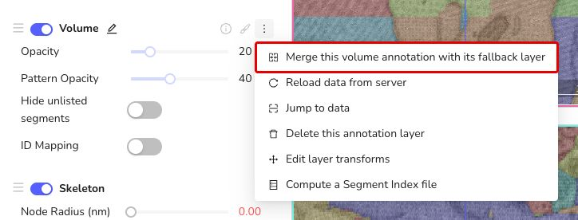

## Import Volume Annotations

Any volume annotation exported from WEBKNOSSOS or the WEBKNOSSOS Python library in a ZIP archive can be imported in one of two ways:

- **From the dashboard** — drag and drop the ZIP file onto the annotation list to create a new annotation. It will open automatically and appear in your annotation list.
- **From within an open annotation** — drop the ZIP file anywhere in the WEBKNOSSOS viewer to merge the imported data into the current annotation. The volume layer must already exist in the annotation before importing.

For importing skeleton-only (NML) files without volume data, see [Import & Export in Skeleton Annotations](../skeleton_annotation/import_export.md).

## Export Volume Annotations

To download an annotation, open **Menu > Download**, choose the data you want, and select a format (WKW or Zarr). You can also go to your annotation dashboard and click **Download** next to the annotation.

For a full overview of all export and download options — including TIFF cutouts and Python library access — see [Data Export through the Web UI](../data/export_ui.md).

A volume annotation is exported as a `.zip` file containing two parts:

- An [NML file](../data/concepts.md#nml-files) — carries the annotation metadata, segment information, and layer configuration.
- A volume data `.zip` — holds the actual voxel label data in either WKW or Zarr format.

Annotations created with the [proofreading tool](../proofreading/proofreading_tool.md) are exported differently: instead of voxel data, the ZIP contains the merge and split edits of the supervoxel graph. See [Exporting Proofreading Results](../proofreading/proofreading_tool.md#exporting-proofreading-results) for details on the format, re-uploading, and limitations.

## Merging volume annotation with fallback data

When annotating a volume layer, you can work on top of an existing segmentation from the dataset — known as a [fallback layer](../data/concepts.md#volume-element). Rather than copying the entire segmentation upfront, WEBKNOSSOS stores only your edits in the annotation layer and reads everything else directly from the original segmentation. This keeps annotations lightweight while still letting you see and build on the existing data.

Once you are done annotating, you can permanently combine both layers into a single, self-contained segmentation in a new dataset. Your annotation edits take precedence wherever you made changes; the original fallback segmentation fills in the rest. This process is sometimes referred to as **materialization**.

To start it, go to the `Layers` tab in the left sidebar, hover over the three-dot menu next to the name of the volume layer, and select `Merge this volume annotation with its fallback layer`.

/// caption
Layer menu entry to open the materialize volume annotation dialog
///

This opens a dialog that submits a long-running job to materialize the volume annotation into a new dataset. Materializing a volume annotation may take a long time, depending on the size of the annotation and the dataset.

You can also materialize annotations made with the proofreading tool. In that case, you need to select a bounding box to export. See [Materializing a Proofread Segmentation](../proofreading/proofreading_tool.md#materializing-a-proofread-segmentation-into-a-new-dataset).

!!! info
    This feature is only available to admins and dataset managers, on webknossos.org or on managed instances that have the WEBKNOSSOS worker configured.

## Restricting magnifications

Volume annotations can be stored at multiple [magnifications](../terminology.md) — `1-1-1` being full resolution, `4-4-2` meaning downsampled by 4× in x/y and 2× in z, and so on. By default, a volume layer contains every magnification of the dataset, and each edit is [automatically written to all of them](./tools.md#annotating-in-different-magnifications). When you label large structures, most of this work goes into the finest magnification, which may make the tools slower and brushing less responsive on some machines.

Restricting a volume layer to a range of magnifications means that labels are only stored in those magnifications. This is useful when:

- **You annotate large structures** such as nuclei, cell bodies or organelles, which don't need full-resolution outlines. Excluding `1-1-1` (or the two finest mags) reduces the data that has to be updated and uploaded with each stroke, so the brush stays responsive and the annotation stays small.
- **You want to annotate while zoomed out.** The volume tools can only be used [up to a certain zoom level](./tools.md#zoom-limits-of-the-tools), counted from the finest magnification of the layer. If the finest mag of the layer is `4-4-4`, the trace and fill tools as well as interpolation work in `4-4-4` instead of being disabled.

WEBKNOSSOS also suggests restricting magnifications when you annotate a large area in a fine magnification.

Keep in mind:

- Choose the finest magnification to match the level of detail you need. Labels can't be more detailed than the finest mag of the layer. If you zoom in further, you still annotate in that mag and the labels may look blocky.
- The restriction is set when the volume layer is created and can't be changed afterwards. If you need a different range later, add a new volume annotation layer.
- If the layer is based on an existing segmentation (a fallback layer), you can only choose among the magnifications of that segmentation.

### When creating an annotation

On the dataset dashboard, click the three-dot menu next to **New Annotation** for the dataset you want to annotate. Use the **Restrict Volume Magnifications** setting to choose the range of magnifications. For example, skipping `1-1-1` or the two finest magnifications is a common choice for large structures.

### When adding a new volume annotation layer

In an open annotation, go to the **Layers** tab on the left sidebar and click **Add Volume Annotation Layer** at the bottom of the layer list. The same magnification slider is available there.
