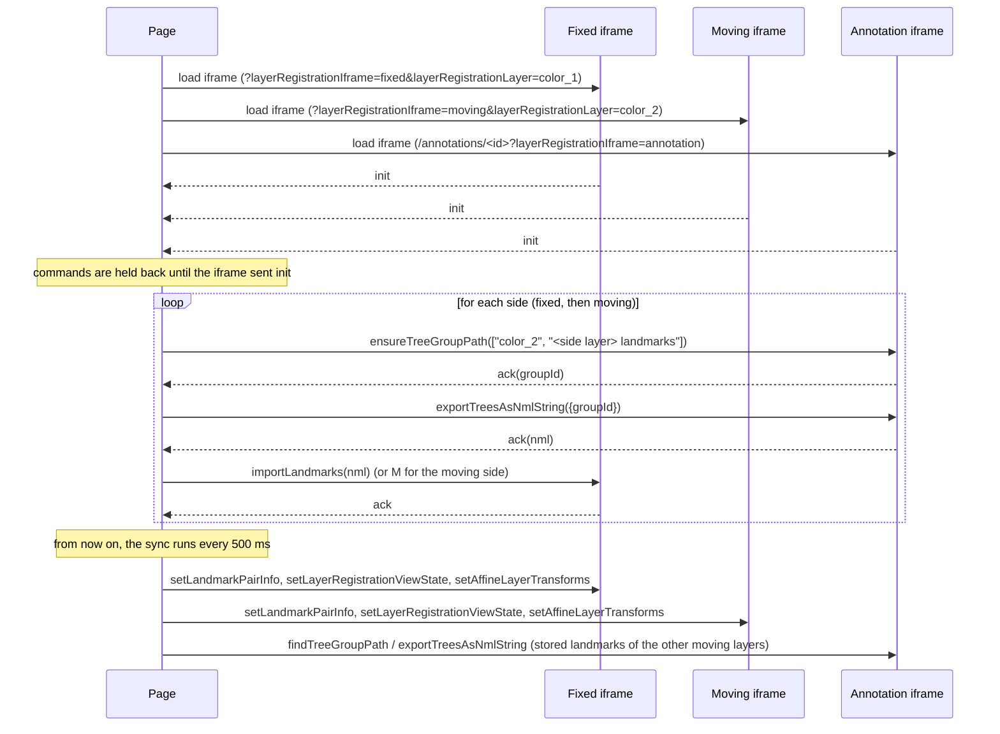
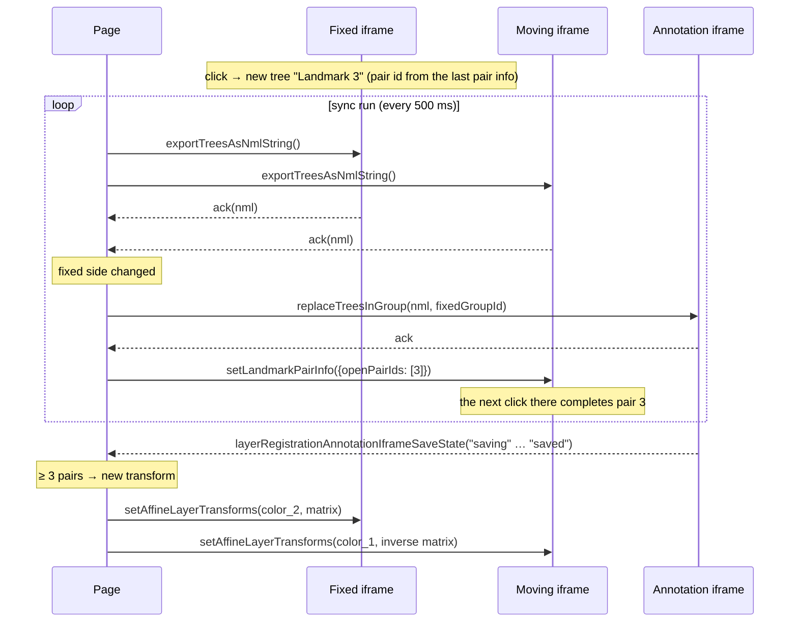
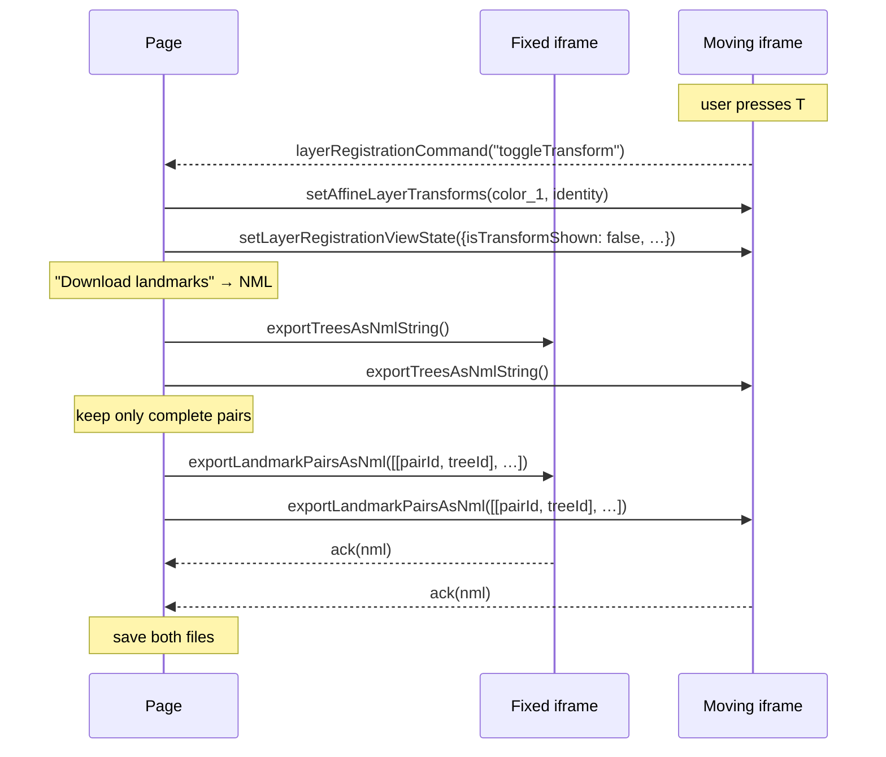
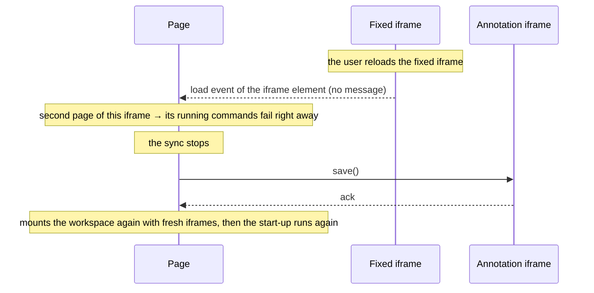

# Layer Registration

The layer registration view registers the layers of a dataset ("moving" layers) to one of its layers (the "fixed" layer). The user places matching landmarks in the fixed layer and in a moving layer. From at least three landmark pairs, the page estimates an affine transform of the moving layer and can write it to the dataset.

This file explains how the page and its iframes work together. The details are in the comments of the files named below.

## Why iframes

The page shows two layers side by side, each with its own camera, skeleton and settings. But the viewer of WEBKNOSSOS can only exist once per page: the Redux store, the model and the API are module-level singletons (see `viewer/singletons.ts`). So the page doesn't render the viewer itself. It embeds the normal viewer in iframes. Each iframe runs its own complete WEBKNOSSOS with its own Redux store, and the page and the iframes only communicate with `postMessage`.

## The page and its iframes

```
Layer registration page: /datasets/<dataset>/register-layers/<annotation id>
┌──────────────────────────┬──────────────────────────┬─────────────────────────────┐
│ fixed iframe             │ moving iframe            │ landmark panel              │
│ (landmark iframe)        │ (landmark iframe)        │                             │
│                          │                          │                             │
│ iframe: sandbox viewer   │ iframe: sandbox viewer   │ no iframe, part of the page,│
│ · shows the fixed layer  │ · shows a moving layer   │ displaying info only        │
│ · user places landmarks  │ · user places landmarks  │ · landmark pairs, errors    │
│                          │                          │ · switches the moving layer │
│                          │                          │ · applies the transforms    │
└──────────────────────────┴──────────────────────────┴─────────────────────────────┘
  Also in the page, but not visible:
  ┌╌╌╌╌╌╌╌╌╌╌╌╌╌╌╌╌╌╌╌╌╌╌╌╌╌╌╌╌╌╌╌╌╌╌╌╌╌╌╌╌╌╌╌╌╌╌╌╌╌╌╌╌╌╌╌┐
  ╎ annotation iframe (hidden)                            ╎
  ╎                                                       ╎
  ╎ iframe: viewer without a scene                        ╎
  ╎ · opens the layer registration annotation             ╎
  ╎ · stores and saves the all landmarks                  ╎
  └╌╌╌╌╌╌╌╌╌╌╌╌╌╌╌╌╌╌╌╌╌╌╌╌╌╌╌╌╌╌╌╌╌╌╌╌╌╌╌╌╌╌╌╌╌╌╌╌╌╌╌╌╌╌╌┘
```

The page itself is not a viewer. Besides the landmark panel, it syncs the landmarks between the iframes and estimates the transform.

- The two **landmark iframes** (the fixed iframe and the moving iframe) open a sandbox annotation of the dataset. The user places the landmarks there. Each one shows only its own layer and offers only the landmark tools. A sandbox is never saved, so the landmarks in a landmark iframe only exist while the page is open.
- The hidden **annotation iframe** opens the layer registration annotation itself. The page reads the stored landmarks from it and writes the changed landmarks to it, and it saves them like any other annotation. It has no scene: it creates no WebGL context and loads no data.

Each iframe reads its role from the params of its URL (see `layer_registration_protocol.ts`, e.g. `isLayerRegistrationLandmarkIframe()`):

- fixed iframe: `/datasets/<dataset>/sandbox/skeleton?layerRegistrationIframe=fixed&layerRegistrationLayer=<fixed layer>`
- moving iframe: `/datasets/<dataset>/sandbox/skeleton?layerRegistrationIframe=moving&layerRegistrationLayer=<moving layer>`
- annotation iframe: `/annotations/<annotation id>?layerRegistrationIframe=annotation`

The role is used in two ways:

- `viewer/viewer_capabilities.ts` (`getViewerCapabilities()`) says what the viewer offers in each role: e.g. the reduced UI of the landmark iframes, whether settings are persisted, and whether there is a scene. Generic viewer code asks for a capability, not for the role.
- The wiring of the feature checks the role directly: e.g. `controller.tsx` (applies the settings of a landmark iframe, reports the save state of the annotation iframe), the navbar, toolbar and viewport layer label of the landmark iframes, and the click handler that names new landmarks.

Sagas never check whether there is a scene. A saga that needs the scene waits with `ensureSceneControllerInitialized`, which never returns in the annotation iframe.

## Messages between the page and the iframes

All messages are declared in `layer_registration_protocol.ts`.

Page → iframe: commands of the cross-origin API (`viewer/api/cross_origin_api.ts`). `IframeCommands` lists them with their arguments and return values.

- A command is `{ type, args, messageId }`. The iframe replies with `ack` (with the return value) or `err`.
- Each iframe sends `init` once its API is ready. It would drop commands that arrive earlier, so the page holds them back until then.
- These commands only run for a page of the same origin, because they read and change the annotation.
- They are implemented in `layer_registration_iframe_commands.ts` (reading and writing the tree groups of the annotation) and in `layer_registration_landmark_iframe.ts` (the commands that only the landmark iframes accept).

Iframe → page:

- `layerRegistrationCommand`: a landmark iframe forwards shortcuts and toolbar buttons that act on the page, e.g. `toggleTransform`.
- `layerRegistrationAnnotationIframeSaveState`: the annotation iframe reports whether the annotation is saved.

On the page side, `IframeBridge` (`workspace/layer_registration_iframe_bridge.ts`) sends the commands, holds them back until `init`, matches the replies by their message id, and ignores messages from other windows or origins. A command fails after a timeout, or right away when its iframe reloads.

## How the landmarks are stored and synced

One layer registration annotation per fixed layer holds the landmarks of all moving layers in tree groups:

```
Layer registration annotation (fixed layer: color_1)
├── color_2                  ← one group per moving layer
│   ├── color_1 landmarks    ← fixed side
│   │   ├── Landmark 1       ← one tree with one node per landmark
│   │   └── Landmark 2
│   └── color_2 landmarks    ← moving side
│       ├── Landmark 1
│       └── Landmark 2
└── color_3
    ├── color_1 landmarks
    └── color_3 landmarks
```

The tree name holds the pair id, which connects the two landmarks of a pair. The landmark iframes only hold the landmarks of the shown moving layer, without groups.

`LandmarkSync` (`workspace/layer_registration_landmark_sync.ts`) keeps both places in sync:

1. At the start, the page reads the stored landmarks of each side from the annotation iframe and imports them into the landmark iframe of that side. Until then, an overlay covers the landmark iframes.
2. From then on, the landmark iframes are the source of truth. Every 500 ms, the page exports the landmarks of both landmark iframes. If a side changed, it replaces the trees in the group of that side in the annotation iframe. Each landmark iframe also gets the pair ids that the other side has and it doesn't, so that its next click completes one of these pairs.
3. The annotation iframe saves with the normal auto-save. The page also calls `save` when it must not lose changes, e.g. before it switches to another moving layer.

The page estimates the transform from the complete pairs and sends it to the landmark iframes (`setAffineLayerTransforms`), so that each one can show the other layer transformed onto its own layer.

## Restart instead of repair

An iframe that loads a new page (e.g. because the user reloaded it) has lost its state: a landmark iframe its landmarks, the annotation iframe its unsaved changes. The page doesn't try to repair this. It saves what was synced, mounts the whole workspace again with fresh iframes, and imports the stored landmarks again. Switching to another moving layer also mounts the workspace again, because the undo history of a landmark iframe can't be cleared.

## Sequence diagrams

The diagrams use a dataset with the fixed layer `color_1` and the moving layer `color_2`. A solid arrow goes from the page to an iframe, a dashed arrow from an iframe to the page.

<details>
<summary>Start-up: loading the iframes and importing the stored landmarks</summary>



</details>

<details>
<summary>Sync: a new landmark in the fixed iframe</summary>



</details>

<details>
<summary>A shortcut in a landmark iframe, and downloading the landmarks</summary>



</details>

<details>
<summary>Restart: the user reloads a landmark iframe</summary>



</details>

## Files

| File | Content |
|---|---|
| `layer_registration_protocol.ts` | Roles, URLs, commands and messages that the page and the iframes agree on |
| `layer_registration_landmark_iframe.ts` | Setup and commands of a landmark iframe, the save state report of the annotation iframe |
| `layer_registration_iframe_commands.ts` | Commands that read and write the tree groups of the annotation |
| `layer_registration_view.tsx` | The page: loads the annotation and the dataset, then mounts the workspace |
| `layer_registration_list_view.tsx` | Lists the layer registration annotations of a dataset and creates new ones |
| `layer_registration_edit_blocker.ts` | Only the owner can work on a layer registration annotation; everyone else can copy it |
| `workspace/` | The page side: the iframes, `IframeBridge`, `LandmarkSync` and the hooks of the workspace |
| `panel/` | The landmark panel right of the iframes |
| `helpers/` | Functions without side effects: pair ids, transform estimation, dataset transforms, hints for the next step |

Outside of this folder: `viewer/viewer_capabilities.ts`, `viewer/api/cross_origin_api.ts`, and the Redux state of a landmark iframe (`layerRegistrationLandmarkIframe` in `viewer/store.ts`), which holds what the page told it.
